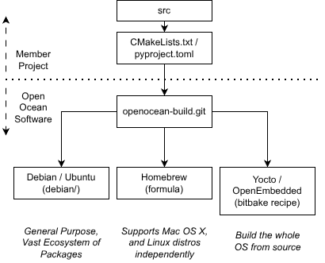

# openocean-build

This repository contains build metadata for our [member projects](https://oceansoft.org/member-projects/).

Member projects are responsible for maintaining source code using git, a working build and install (CMake for C/C++, pyproject.toml for Python, etc.), and a tagged release schedule. From there, Open Ocean Software handles the secure build pipeline and package repository.



We are working to support multiple distribution ecosystems, based on a tiered approach (Tier 1 is highest priority).


## Tier 1

- Debian and Ubuntu (*.deb): These Linux distributions are widely used in the marine robotics community, and have a vast collection of existing packages.

## Tier 2

- OpenEmbedded (Yocto): used by many embedded developers to create bespoke filesystems from source.
- Homebrew: supports MacOS X and can be used on many Linux distros as well (independent of the system package manager).

## Installing packages

*This section was written by Claude.*

Packages are published per channel at `apt/<channel>/<distro>-<dist>`. For example, the release channel for Debian trixie, in `/etc/apt/sources.list.d/openocean.sources`:

```
Types: deb
URIs: https://openocean-build.s3.us-east-1.amazonaws.com/apt/release/debian-trixie
Suites: trixie
Components: main
Signed-By: /usr/share/keyrings/openocean-release.asc
```

The release channel is signed with the key in [`keys/release.asc`](keys/release.asc) (fingerprint `EAD2 78F6 A256 44C2 C559  DBB6 D28A 2EAB 14D2 A9E5`). Save it as `/usr/share/keyrings/openocean-release.asc`.

## Adding a project

*This section was written by Claude.*

Each project is a directory in `projects/`:

- `project.yaml`: where the source comes from, and any settings that differ from `defaults.yaml` (build targets, install-test checks).
- `debian/`: the Debian packaging.
- `maintainers.yaml` and `keys/` (for `source: git` with `require_signed_tag`): the people whose signed release tags are trusted, and their GPG public keys or SSH keys. Only these keys are trusted for this project.

`ci/project-config <project> get <setting>` shows the merged settings. To build locally, see the top of the `Makefile`.

A change to `projects/<project>/debian/changelog` on `main` releases that project (`.github/workflows/release.yml`), after approval in the `release` GitHub Environment. Before publishing, every package is installed on a clean Ubuntu 26.04 system and the project's `install_test` commands are run.
