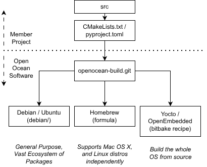

# openocean-build

This repository contains build metadata for our [member projects](https://oceansoft.org/member-projects/).

Member projects are responsible for maintaining source code using git, a working build and install (CMake for C/C++, pyproject.toml for Python, etc.), and a tagged release schedule. From there, Open Ocean Software handles the secure build pipeline and package repository.



We are working to support multiple distribution ecosystems, based on a tiered approach (Tier 1 is highest priority).


## Tier 1

- Debian and Ubuntu (*.deb): These Linux distributions are widely used in the marine robotics community, and have a vast collection of existing packages.

## Tier 2

- OpenEmbedded (Yocto): used by many embedded developers to create bespoke filesystems from source.
- Homebrew: supports MacOS X and can be used on many Linux distros as well (independent of the system package manager).

## Installing packages

*This section was written by Claude.*

Packages are published per channel at `https://apt.oceansoft.org/<channel>/<distro>-<dist>`. For example, the release channel for Debian trixie, in `/etc/apt/sources.list.d/openocean.sources`:

```
Types: deb
URIs: https://apt.oceansoft.org/release/debian-trixie
Suites: trixie
Components: main
Signed-By: /usr/share/keyrings/openocean-release.asc
```

The release channel is signed with the key in [`keys/release.asc`](keys/release.asc) (fingerprint `EAD2 78F6 A256 44C2 C559  DBB6 D28A 2EAB 14D2 A9E5`). Save it as `/usr/share/keyrings/openocean-release.asc`.

For prereleases, add the beta channel as well, signed with the same key:

```
Types: deb
URIs: https://apt.oceansoft.org/beta/debian-trixie
Suites: trixie
Components: main
Signed-By: /usr/share/keyrings/openocean-release.asc
```

A prerelease such as `0.1.0~beta.1` sorts below `0.1.0`, so the final release replaces it once published.

The continuous channel has a build of the latest commit on each project's default branch, for projects that enable it. A commit is only built if one of the project's maintainers signed it or merged it in GitHub's web UI. It's signed with its own key, [`keys/continuous.asc`](keys/continuous.asc) (fingerprint `DAF0 8DD7 788E 6C84 C6F8  E8D3 E59E 1A81 FECD B228`):

```
Types: deb
URIs: https://apt.oceansoft.org/continuous/debian-trixie
Suites: trixie
Components: main
Signed-By: /usr/share/keyrings/openocean-continuous.asc
```

Continuous versions look like `0.1.0~beta.1+git3.gabc1234-0oos6`: three commits after the `v0.1.0-beta.1` tag, at commit `abc1234`. They sort above that tag's package and below the next release, and only the newest five per project are kept.

## Adding a project

*This section was written by Claude.*

Each project is a directory in `projects/`:

- `project.yaml`: where the source comes from, and any settings that differ from `defaults.yaml` (build targets, install-test checks).
- `debian/`: the Debian packaging.
- `maintainers.yaml` and `keys/` (for `source: git` with `require_signed_tag`): the people whose signed release tags are trusted, and their GPG public keys or SSH keys. Only these keys are trusted for this project.

`ci/project-config <project> get <setting>` shows the merged settings. To build locally, see the top of the `Makefile`.

With `continuous: enabled: true` in its `project.yaml` (and `source: git`), `.github/workflows/continuous.yml` also builds the project's default-branch head every 6 hours, or on a `repository_dispatch` event of type `continuous` naming the project.

A change to `projects/<project>/debian/changelog` on `main` releases that project (`.github/workflows/release.yml`), after approval in the `release` GitHub Environment. If the version's upstream tag matches the project's `release.beta_tags`, it goes to the beta channel instead (e.g. `0.1.0~beta.1-1`, tag `v0.1.0-beta.1`). Before publishing, every package is installed on a clean Ubuntu 26.04 system and the project's `install_test` commands are run.
