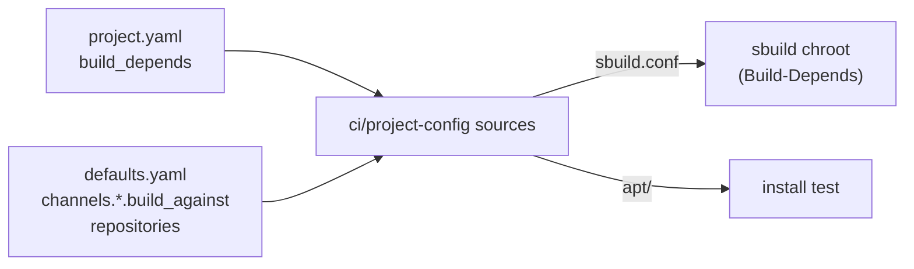

# Build dependencies

*This documentation section was written by Claude.*

A project can build-depend on packages that Debian and Ubuntu don't ship: other projects' packages from our own channels, and packages from external repositories such as Eclipse Zenoh's. In its `project.yaml`:

```yaml
build_depends:
  projects: [dccl]          # projects in projects/ or dependencies/
  repositories: [zenoh]     # names in defaults.yaml's repositories
```

The sbuild chroot then has those apt sources (with their keys) while it installs `Build-Depends`, and the install test has the same sources, so the packages' runtime dependencies install too. `ci/project-config <project> sources <channel> <distro> <dist> <dir>` writes them, for a look at what a build will use.



## Our channels

`build_depends.projects` adds our channels, which ones depending on the channel being built for (`channels.<channel>.build_against` in `defaults.yaml`):

| Building for | Build-depends from |
|---|---|
| release | release |
| beta | release, beta |
| continuous | release, continuous |

So a release only ever builds against released packages, while a continuous build of a project can use a continuous build of its dependency. A channel not yet published for a target (say, beta for a release no prerelease has reached) is left out.

Every target a project builds, its dependencies must build too; `project-config` refuses the configuration otherwise.

## Order and pull requests

`release.yml` and `continuous.yml` build and publish dependencies first (`ci/project-config order`): a project releasing alongside one of its dependencies waits for the dependency to be published.

A pull request can't release a project and a project that build-depends on it together: its checks would build the dependent against the dependency's *old* packages. Release the dependency first, then the dependent in a second pull request. The check fails with which pair to split.

## External repositories

`defaults.yaml`'s `repositories` lists the external apt repositories projects can use:

```yaml
repositories:
  zenoh:
    url: https://download.eclipse.org/zenoh/debian-repo/
    suite: /                  # flat repository
    components: []
    key: trust/zenoh.asc
    fingerprint: 0ABC5913672BBE50921B3B9395D19EA1F7DF9E8E
    pin:
      packages: [libzenohc, libzenohc-dev, libzenohcpp-dev]
      version: 1.10.2
```

`{distro}` and `{dist}` in `url` and `suite` are replaced by the build target's, for repositories with a suite per release (`url: http://packages.ros.org/ros2/{distro}`, `suite: "{dist}"`). The key is checked into `trust/` and the tests check it has `fingerprint`. A `pin` holds the listed packages at that version (an apt preference of priority 1001) in builds and install tests alike: repositories like Eclipse's keep every version, and a build should use the one we chose, not whatever is newest that day. Changing the pin is a pull request like any other.

Users of a package that depends on an external repository need that repository too; [Installing packages](installing.md) has a script that adds it.

## Local builds

`make debian-sbuild` writes the sources to `build/<project>/<distro>-<dist>-<arch>-sources/` and builds for the release channel; `CHANNEL=continuous` (or `beta`) builds for another.
