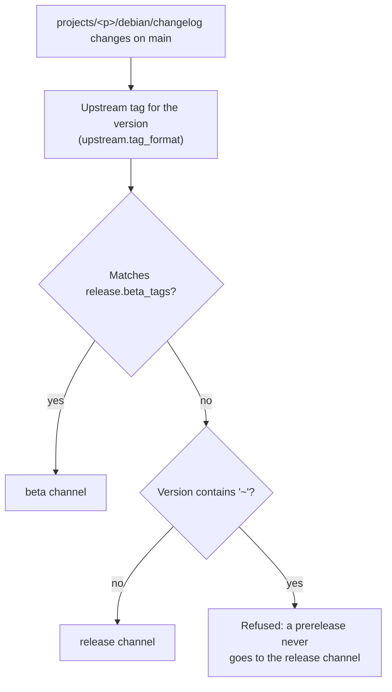

# Channels

*This documentation section was written by Claude.*

Packages are published to three channels, each its own set of apt repositories:

| | Release | Beta | Continuous |
|---|---|---|---|
| Contents | Tagged releases | Tagged prereleases | The latest commit on each project's default branch (or `continuous.branch`) |
| Started by | A `debian/changelog` change on `main` | A `debian/changelog` change on `main` | The 6-hour poll, or a push to the project ([Continuous builds](continuous.md)) |
| Source must be | A release tag signed by a maintainer (projects with `release.require_signed_tag`) | Same as release | A commit signed by a maintainer, or merged by one in GitHub's web UI |
| Approval | A required reviewer in the `release` GitHub Environment; the waiting job is named after the project, version and channel | Same as release | None |
| Signed with | [Release key](keys.md#release-key) | [Release key](keys.md#release-key) | [Continuous key](keys.md#continuous-key) |
| Kept | Every version | Every version | The newest 5 versions per project |
| URL | `apt.oceansoft.org/release/…` | `apt.oceansoft.org/beta/…` | `apt.oceansoft.org/continuous/…` |

The channels are configured in `defaults.yaml` (`channels:`). Release and beta share the `release` GitHub Environment, whose AWS credentials can only write `apt/release/*` and `apt/beta/*`. The `continuous` Environment has its own signing key and AWS credentials that can only write `apt/continuous/*`, and only deploys from `main`, so a leaked continuous credential can't touch a release.

## Release or beta

The changelog version maps to the upstream tag with the project's `upstream.tag_format` and `upstream.prerelease_separator`: Debian's `~` becomes the separator, and a repack suffix (`+dfsg`, `+ds`) is dropped. For example:

| Project | Debian version | Upstream tag | Channel |
|---|---|---|---|
| openocean-messages | `0.0.1~beta.3-1` | `v0.0.1-beta.3` | beta |
| moos-ivp | `24.8.1+dfsg-3` | `v24.8.1` | release |
| dccl | `5.1.1-1` | `5.1.1` | release |
| dccl | `5.2.0~rc1-1` | `5.2.0_rc1` | beta |

`release.yml` can also be started by hand for one project (*Run workflow* in the Actions tab), to build and publish its current changelog version again, e.g. after a failed run.

## Continuous versions

A continuous build's version is `<nearest tag's version>+git<commits since>.g<commit>-0oos<packaging changes>`, e.g. `0.1.0~beta.1+git3.gabc1234-0oos6`: three commits after the `v0.1.0-beta.1` tag, at commit `abc1234`, with the sixth revision of `projects/
/` in this repository. It sorts above that tag's release, and below the next one.

## Before publishing

Every build, in every channel, is installed on a clean Ubuntu 26.04 (amd64) system before it's published: first the older versions of its packages already published in that channel (to test upgrading), then the new packages, then the project's `install_test` commands are run in its source tree. Pull requests to this repository run the same build and install test for the projects they change, without publishing.
