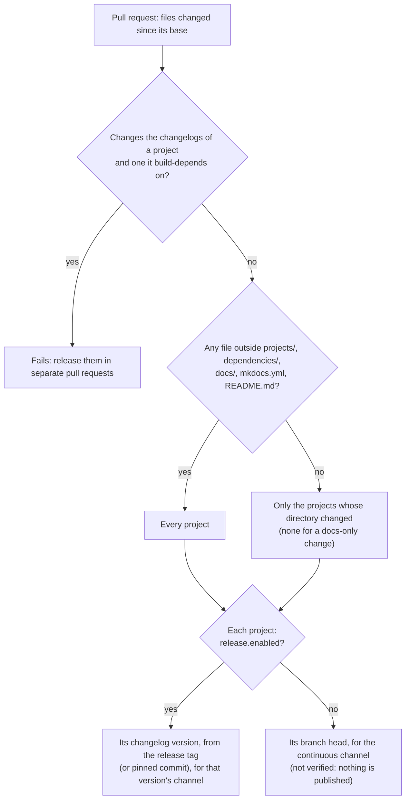

# CI

*This documentation section was written by Claude.*

Four workflows in `.github/workflows/` build projects. Three of them start on their own. All three call `build-debian.yml`, which builds, install-tests and (if asked) publishes one project.

| Workflow | Starts on | Builds | Targets | Publishes |
|---|---|---|---|---|
| `check.yml` | Every pull request, and each push to one | The projects the pull request affects | The install-test target only | No |
| `release.yml` | A push to `main` that changes a `debian/changelog`, or by hand | The projects whose changelog changed | All | Yes, to release or beta, after approval |
| `continuous.yml` | Every 6 hours, a push to a project's repository, or by hand | Projects with `continuous.enabled` whose head is new and trusted | All | Yes, to continuous, without approval |

The install-test target is `install_test.target`: Ubuntu 26.04 amd64 unless a project sets another.

Two more workflows don't build packages:

- `security.yml`, the weekly [security scan](security.md).
- `docs.yml`, which publishes this documentation to [build.oceansoft.org](https://build.oceansoft.org) (GitHub Pages) when `docs/` or `mkdocs.yml` changes on `main`.

## What a change starts

| A change to | The pull request's check builds | Merging it to `main` |
|---|---|---|
| `projects/
/debian/changelog` or `dependencies/
/debian/changelog` | `
` | Releases `
` |
| Anything else in `projects/
/` or `dependencies/
/` | `
` | Nothing, until `
`'s next release or continuous build |
| `docs/`, `mkdocs.yml` or `README.md` only | No project (tests and docs only) | Nothing |
| Anything else (`ci/`, `.github/`, `Makefile`, `defaults.yaml`, `docker/`, `keys/`, `trust/`, …) | Every project | Nothing |

The check compares the whole pull request with its base, not just the latest push. So if the pull request changes the shared build anywhere, even a push that only touches `docs/` rebuilds every project. A newer push cancels the check still running for the same pull request.

`check.yml` always lints and tests `ci/` and builds the docs. Which projects it builds:

The check fetches the same source the release would. So the upstream tag for a new changelog version must be pushed before the pull request's check can pass.

## Releases

`release.yml` releases each project whose `debian/changelog` changed in the push to `main`:

- A project with `release.enabled: false` is skipped. Its log says so.
- Projects are released one at a time, each after the projects it build-depends on.
- Each release builds every target, install-tests, then waits in the channel's GitHub Environment. The waiting job is named after the project, version and channel. An approver accepts or rejects it there.
- *Run workflow* in the Actions tab rebuilds and republishes one project's current changelog version, e.g. after a failed run.

Merging changes to a project's packaging without a changelog entry releases nothing.

## Continuous builds

`continuous.yml` looks up the head of each [continuous project](continuous.md)'s branch and skips it when:

- the project doesn't have `continuous.enabled`. This includes every project in `dependencies/`. Started by hand for such a project, the run fails instead.
- the run is the 6-hour poll and the project has `continuous.push_dispatch: true`. Those projects are built when their repository is pushed to.
- the head isn't [trusted](trust.md#continuous-builds-signed-or-merged-heads). The reason is in the run's summary.
- the head's version is already published. Quiet projects cost a lookup, not a build.

The version includes a count of commits to the project's directory in this repository, so a packaging change gives the same head a new version. A polled project rebuilds it at the next poll. A `push_dispatch` project rebuilds it at the next push to its repository, or when the workflow is started by hand.
