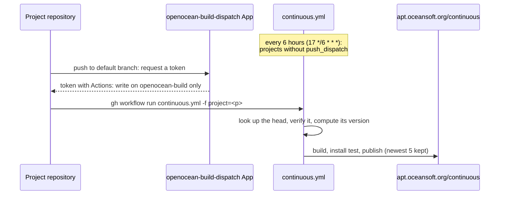

# Continuous builds

*This documentation section was written by Claude.*

A project opts in with, in its `project.yaml` (it also needs `source: git` and a `maintainers.yaml`):

```yaml
continuous:
  enabled: true
```

`.github/workflows/continuous.yml` then builds the head of the project's default branch (or of `continuous.branch`), if it's [trusted](trust.md#continuous-builds-signed-or-merged-heads) and not already published, and publishes it to the [continuous channel](channels.md). A build can be started three ways:

| | Every 6 hours | On each push | By hand |
|---|---|---|---|
| Builds | Every project with `continuous.push_dispatch: false` | The project that was pushed | The project named |
| Delay after a push | Up to 6 hours | Minutes | |
| Needs | Nothing | A workflow in the project's repository, and the dispatch App | Write access to openocean-build |



## Every 6 hours

Projects with `continuous.push_dispatch: false` (the default) are polled at 17 minutes past every sixth hour (UTC). This needs nothing from the project, so it's the way to start. A head that's already published is skipped, so a quiet project costs a `git ls-remote` and a clone of its history.

## On each push

To build within minutes of each push, the project's repository starts `continuous.yml` itself. It does so with the `openocean-build-dispatch` GitHub App, whose only permission is Actions: write on openocean-build: it can start workflows, but not change code. The workflow input only names the project; `continuous.yml` looks up and verifies the head itself, so a misused token can at most cause a check.

To set it up for a project:

1. Give the project's repository the App's credentials: the `OOS_DISPATCH_APP_ID` variable and `OOS_DISPATCH_APP_KEY` secret. For a repository in the `openocean-software` organization, give it access to the organization's copies (both have "selected repositories" access). A repository elsewhere (e.g. GobySoft/dccl) needs its own copies, in its *Secrets and variables → Actions* settings; the App stays installed only on openocean-software. Give each such repository its own key (the App's settings, *Credentials → Key pairs → New key*), so one can be revoked without breaking the others.
2. Add `.github/workflows/notify-openocean-build.yml` to the project, changing the project name in the last step:

    ```yaml
    name: Notify openocean-build

    on:
      push:
        branches: [main]

    permissions: {}

    jobs:
      notify:
        runs-on: ubuntu-latest
        steps:
          - name: Get a token for openocean-build
            id: token
            uses: actions/create-github-app-token@v2
            with:
              app-id: ${{ vars.OOS_DISPATCH_APP_ID }}
              private-key: ${{ secrets.OOS_DISPATCH_APP_KEY }}
              owner: openocean-software
              repositories: openocean-build

          - name: Start openocean-build's continuous build
            env:
              GH_TOKEN: ${{ steps.token.outputs.token }}
            run: gh workflow run continuous.yml --repo openocean-software/openocean-build --ref main -f project=<project>
    ```

    openocean-messages' [copy](https://github.com/openocean-software/openocean-messages/blob/main/.github/workflows/notify-openocean-build.yml) also checks the token on pull requests that change the workflow.

3. Set `continuous.push_dispatch: true` in the project's `project.yaml`, so the 6-hour poll leaves it out.


## By hand

From the Actions tab (*Continuous* → *Run workflow*), or:

```bash
gh workflow run continuous.yml --repo openocean-software/openocean-build -f project=dccl
```

## Versions and retention

Versions look like `5.1.1+git9.g70fa05e-0oos1`: see [Channels](channels.md#continuous-versions). Only the newest 5 versions of each project are kept (`channels.continuous.keep` in `defaults.yaml`); older ones are removed from the index and the pool.
