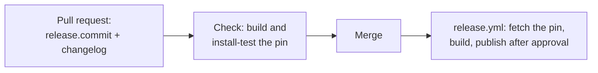

# Dependency projects

*This documentation section was written by Claude.*

A dependency project packages software that a member project needs but that Debian and Ubuntu don't ship, such as MAVLink for goby3. Dependency projects live in `dependencies/<name>/`, with the same layout as `projects/` (`project.yaml`, and a `debian/` named after the source package). Every script and workflow finds a project in either directory, and a project's `build_depends.projects` can name projects from both.

| Project | Upstream | Release |
|---|---|---|
| mavlink | [mavlink/mavlink](https://github.com/mavlink/mavlink), with the pymavlink submodule | commit of master (no upstream tags) |

## Trusting a pinned commit

Nobody listed as a maintainer signs a dependency's source, so the source isn't trusted through a signature. Instead, the project pins it:

```yaml
release:
  commit: 4b03484ee7b296c8f1ecd50ece4b9893baff90e8   # the full hash
```

A pull request reviews that line, CODEOWNERS covers `dependencies/*/project.yaml`, and the pull request's check builds the pinned source. `ci/fetch-source` refuses to build anything else:

- With an upstream tag (`upstream.tag_format`), the tag must point at the pinned commit, so a tag moved after review fails the build.
- Without upstream tags (`tag_format: null`), the commit itself is fetched.
- With `upstream.submodules: true`, submodules are included at the commits that the pinned source records, so the pin covers them too.

Dependency projects have no continuous builds, because nobody we list vouches for upstream's newer commits. A member project can't use `release.commit`; it signs its tags instead (see [Signing and trust](trust.md)).

## Upstreams without tagged releases

Some upstreams don't tag releases. MAVLink, for example, hasn't since 1.0.12 in 2019 ([mavlink/mavlink#2115](https://github.com/mavlink/mavlink/issues/2115)). A release of such a project is a commit of upstream's branch, and its version records the commit and when it was committed:

```
2.0.0+git20260507.4b03484-0oos1
│     │   │        │       └ our packaging revision
│     │   │        └ the commit's first 7 hex digits
│     │   └ the commit's date (committer date, UTC)
│     └ a snapshot, not a release
└ base: the release the snapshots follow
```

`ci/project-config` checks that the hash in the version is `release.commit`'s, and `ci/fetch-source` checks the date. A new pin is therefore always a new, higher version. Choose the base once and keep it:

- If an earlier package exists, use a base that sorts its versions below ours. For mavlink, base `2.0.0` makes `2.0.0+git…` sort above packages.gobysoft.org's `2.0.0+20260507`, so those users upgrade.
- Otherwise, use upstream's last tag, or `0`.

To release a newer upstream commit, change `release.commit` and add a changelog entry with the matching version in the same pull request.



If upstream starts tagging, set `upstream.tag_format` to the tag's format and use upstream's version from then on. Keep `release.commit`: fetch-source then checks that the tag still points at the pinned commit.
