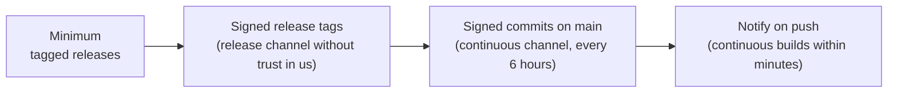

# Getting started for member projects

*This documentation section was written by Claude.*

This page is for the maintainers of a member project. You keep your source in git, with a build that installs, and you tag releases. Open Ocean Software turns those releases into signed Debian and Ubuntu packages, published at apt.oceansoft.org. The more of the practices below your project follows, the less of its release has to be taken on trust, and the sooner its users get its changes.



## Minimum: tagged releases

<!-- TODO (maintainers): how a project applies to become a member project, and who to contact. -->

- **Public git repository.** GitHub is easiest. Releases are fetched with git, by tag.
- **A build that installs.** Use CMake `install()` rules for C/C++, or `pyproject.toml` for Python. A library should also install a CMake package (`find_package(<name>)`) and give each shared library a SOVERSION. Without a SOVERSION, an incompatible release can't be told apart.
- **Tagged releases.** Tag each release with its version, using one format throughout, e.g. `v1.2.0` or `1.2.0`. Never move or reuse a tag. Prereleases use a suffix, e.g. `v1.3.0-rc.1`; they can go to the beta channel (see [Channels](channels.md#release-or-beta)).
- **Dependencies we can get.** Every dependency should be in Debian and Ubuntu, in one of our channels, or packaged with us (see [Dependency projects](dependencies.md)). Tell us about any that aren't.
- **A license** that lets us redistribute the packages.

What happens then:

1. A pull request to this repository adds `projects/<name>/` (see [Projects](projects.md#adding-a-project)). We write the Debian packaging with you.
2. For each release, you push the tag. Then a pull request here adds the version to `projects/<name>/debian/changelog`.
3. Merging that pull request builds the release on every target and install-tests it. It's published after an Open Ocean Software maintainer approves.

## Best practices

### Sign your release tags

When you sign tags, a release is built only from a tag that one of your project's maintainers signed. Nobody else, including us, can substitute different source. See [Signing and trust](trust.md#releases-signed-tags).

1. Use a GPG key, or an SSH key set up for git signing.
2. Send us the key and your GitHub login. We list them in `projects/<name>/maintainers.yaml` and `keys/`.
3. Tag with a signed, annotated tag, and push it:

    ```bash
    git tag -s v1.2.0 -m "Release 1.2.0"
    git push origin v1.2.0
    ```

We then set `release.require_signed_tag: true` for your project. From then on, an unsigned tag fails the build.

### Continuous builds: a trusted `main`

The continuous channel carries a build of each new head of your default branch. A head is built only if it's trusted, in one of two ways:

- **A maintainer signed the commit.** Sign every commit, including merge commits:

    ```bash
    git config --global commit.gpgsign true   # or -S on each commit
    ```

- **A maintainer merged a pull request in GitHub's web UI.** GitHub signs these merges, and the maintainer's GitHub login identifies who merged.

A head that is neither is skipped until a trusted commit lands on top of it. The reason is given in the run's summary. So merge pull requests in the web UI or with `git merge -S`, and don't push other people's unsigned commits straight to `main`. Protecting `main` with required reviews and signed commits makes this the default. It also raises your project's [Scorecard](security.md).

Once `main` is trusted, we set `continuous.enabled: true`, and new heads are built every 6 hours.

### Notify us on each push

To have a head built within minutes instead, your repository starts our continuous build itself on each push to `main`:

1. Add our dispatch App's ID and key to your repository: the `OOS_DISPATCH_APP_ID` variable and the `OOS_DISPATCH_APP_KEY` secret. We send you a key for your repository only.
2. Add `.github/workflows/notify-openocean-build.yml` (the template is in [Continuous builds](continuous.md#on-each-push)).
3. We set `continuous.push_dispatch: true`.

The App can start our workflows but can't change any code. The notification names only your project, and the head it builds is looked up and verified on our side.

### Help us test what we publish

Every package is installed on a clean system, and checked, before it's published. Tell us a few commands that show your package works: the tools' `--help`, a small program built against your library, or a short run. They become the project's `install_test` (see [Projects](projects.md#adding-a-project)).

### Security

Each week, [security scanning](security.md) checks your releases for known vulnerabilities and rates your repository with OpenSSF Scorecard. Low-effort improvements:

- a `SECURITY.md` explaining how to report a vulnerability;
- branch protection on `main`;
- workflows with read-only token permissions and actions pinned by hash;
- dependency updates (e.g. Dependabot).

## At a glance

| | Minimum | Best practice |
|---|---|---|
| Source | Public git repository | Branch protection on `main` |
| Build | Installs, with SOVERSIONs | CMake package for libraries |
| Releases | Version tags, never moved | Signed tags; prereleases as `-rc.N` for the beta channel |
| Continuous builds | No | Signed or web-merged commits on `main`, notify on push |
| Testing | Our install test | Your smoke-test commands in the install test |
| Security | Weekly scan | `SECURITY.md`, a higher Scorecard |
