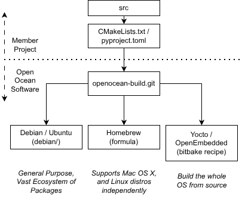
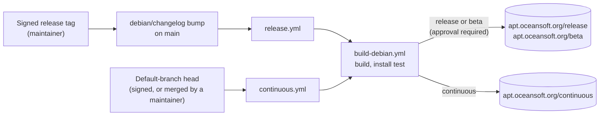

# openocean-build

This repository contains build metadata for our [member projects](https://oceansoft.org/member-projects/).

Member projects are responsible for maintaining source code using git, a working build and install (CMake for C/C++, pyproject.toml for Python, etc.), and a tagged release schedule. From there, Open Ocean Software handles the secure build pipeline and package repository.

We are working to support multiple distribution ecosystems, based on a tiered approach (Tier 1 is highest priority).

- **Tier 1**: Debian and Ubuntu (`.deb`). These Linux distributions are widely used in the marine robotics community, and have a vast collection of existing packages.
- **Tier 2**: OpenEmbedded (Yocto), used by many embedded developers to create bespoke filesystems from source; Homebrew, which supports macOS and can be used on many Linux distributions as well.

## How a package gets published

*This documentation section was written by Claude.*

- [Installing packages](installing.md): apt sources for each channel.
- [Channels](channels.md): release, beta and continuous, and what goes where.
- [CI](ci.md): which workflow builds what, and when a project is skipped.
- [Signing and trust](trust.md): which signatures a release or continuous build needs.
- [Security scanning](security.md): known vulnerabilities and Scorecard results for each project's upstream.
- [Keys](keys.md): the keys that sign the repositories, and the keys the build trusts.
- [Continuous builds](continuous.md): the 6-hour poll, and starting a build on each push.
- [Projects](projects.md): the projects built here, and adding a new one.
