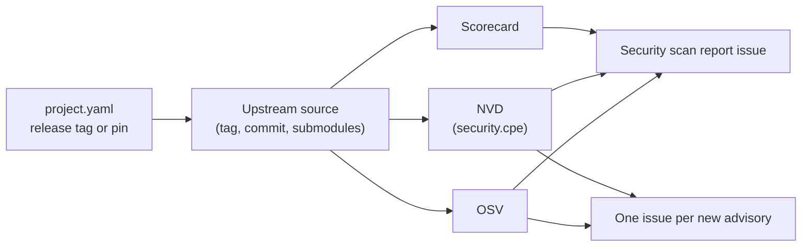

# Security scanning

*This documentation section was written by Claude.*

`ci/security-scan` checks the upstream source that each project in `projects/` and `dependencies/` releases. That source is the release tag, or `release.commit` if pinned. A snapshot-only project uses its branch head instead. The scan also covers submodules, at the commits the source records. It reports:

- **Known vulnerabilities**, from two sources:
    - [OSV](https://osv.dev), which is asked about each commit, and about the tag as a version of the upstream repository.
    - [NVD](https://nvd.nist.gov), which is asked about the project's `security.cpe` at the release's version.
- **The [OpenSSF Scorecard](https://scorecard.dev)** of the upstream repository. It comes from Scorecard's weekly dataset when the repository is in it. Otherwise the workflow runs Scorecard on the repository itself.

## When it runs

`.github/workflows/security.yml` runs:

- **Every Monday, and by hand.** It updates the open *Security scan report* issue, and opens an issue for each advisory that has none yet. The issue is titled `Security: <project> is affected by <ID>`. Closing it, after deciding our packages aren't affected or after fixing them, keeps it from being opened again.
- **On a pull request** that changes a `project.yaml`, a changelog, `defaults.yaml` or the scan itself. The report goes to the run summary, so a pin or version bump is reviewed with its advisories. No issues are opened.

A finding never fails a build. A low Scorecard score is a reason to look closer at an upstream, not a verdict.

## Limits

- **OSV** knows the vulnerabilities whose records name affected commits or tags of the repository. Many CVEs in C and C++ libraries are recorded only in NVD, by CPE. For those, set `security.cpe` in the project's `project.yaml`, e.g. `cpe:2.3:a:<vendor>:<product>`, with the vendor and product NVD uses.
- **NVD** is asked only about a tagged version. An untagged pin (`tag_format: null`) has no version NVD would know.
- **Scorecard** rates the repository's practices at its default branch now, not the pinned commit.

To raise NVD's rate limit, add an API key as the `NVD_API_KEY` repository secret.

`ci/security-scan --project 
` runs the same scan locally. It needs network access to api.osv.dev, api.securityscorecards.dev and services.nvd.nist.gov.
