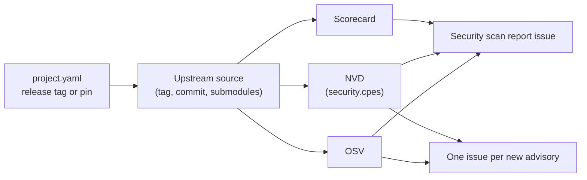

# Security scanning

*This documentation section was written by Claude.*

`ci/security-scan` checks the upstream source that each project in `projects/` and `dependencies/` releases. That source is the release tag, or `release.commit` if pinned. A snapshot-only project uses its branch head instead. The scan also covers submodules, at the commits the source records. It reports:

- **Known vulnerabilities**, from two sources:
    - [OSV](https://osv.dev), which is asked about each commit, and about the tag as a version of the upstream repository.
    - [NVD](https://nvd.nist.gov), which is asked about each of the project's `security.cpes` at the release's version.
- **The [OpenSSF Scorecard](https://scorecard.dev)** of the upstream repository. It comes from Scorecard's weekly dataset when the repository is in it. Otherwise the workflow runs Scorecard on the repository itself.



## When it runs

`.github/workflows/security.yml` runs:

- **Every Monday, and by hand.** It updates the open *Security scan report* issue, and opens an issue for each advisory that has none yet. The issue is titled `Security: <project> is affected by <ID>`. Closing it, after deciding our packages aren't affected or after fixing them, keeps it from being opened again.
- **On a pull request** that changes a `project.yaml`, a changelog, `defaults.yaml` or the scan itself. The report goes to the run summary, so a pin or version bump is reviewed with its advisories. No issues are opened.

A finding never fails a build. A low Scorecard score is a reason to look closer at an upstream, not a verdict.

## Setting a project's CPEs

```yaml
security:
  cpes: ["cpe:2.3:a:emweb:wt", "cpe:2.3:a:webtoolkit:wt"]   # Wt's CVEs use both vendors
```

Find a project's CPEs from its CVEs on [nvd.nist.gov](https://nvd.nist.gov/vuln/search). Each CVE's *Known Affected Software Configurations* section names them.

| Project | CPEs |
|---|---|
| moos-ivp | `cpe:2.3:a:mit:moos-ivp` |
| wt | `cpe:2.3:a:emweb:wt`, `cpe:2.3:a:webtoolkit:wt` |

## Limits

- **OSV** knows the vulnerabilities whose records name affected commits or tags of the repository. Many CVEs in C and C++ libraries are recorded only in NVD, so they need `security.cpes`.
- **NVD's version ranges** are sometimes narrower than its own descriptions. For example, a record may say "through 24.8.1" in words while its range ends before 24.8.1. So a CVE of the product whose description names the release's exact version counts too.
- **NVD records awaiting analysis** have no CPE yet, so they aren't found until NVD analyses them.
- **NVD is asked only about a tagged release.** That excludes an untagged pin (`tag_format: null`), which has no version NVD knows. It also excludes a snapshot project, which may already carry fixes made after the release its version follows.
- **Scorecard** rates the repository's practices at its default branch now, not the pinned commit.

To raise NVD's rate limit, add an API key as the `NVD_API_KEY` repository secret.

`ci/security-scan --project <p>` runs the same scan locally. It needs network access to api.osv.dev, api.securityscorecards.dev and services.nvd.nist.gov.
