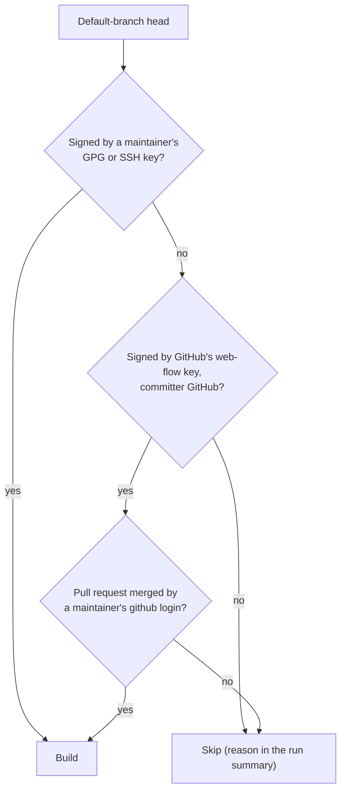

# Signing and trust

*This documentation section was written by Claude.*

openocean-build only builds source that one of the project's maintainers has vouched for. Each project lists its maintainers in `projects/<project>/maintainers.yaml`, with their public keys in `projects/<project>/keys/`:

```yaml
maintainers:
  - name: Toby Schneider
    github: tsaubergine          # for web-UI merges (continuous builds)
    gpg: ["A422 D0D2 1761 C039 62BB  3546 3372 3E2F 080B 6743"]
    # ssh: ["ssh-ed25519 AAAA…"] # SSH signing keys are accepted too
```

Maintainers are per project: a maintainer of one project is trusted on no other. Only the listed fingerprints are trusted, even if `keys/` holds other keys. `ci/verify-signature` makes every check below, and `.github/CODEOWNERS` requires review for changes to `maintainers.yaml` and `keys/`.

## Releases: signed tags

With `release.require_signed_tag: true` (and `source: git`), a release is built from the upstream tag for the changelog version, and the build fails unless that tag is signed by one of the project's maintainers:

```bash
git tag -s v0.1.0 -m "Release 0.1.0"
git push origin v0.1.0
```

The tag must be an annotated, signed tag. A signed commit under an unsigned tag isn't enough, since the tag can be moved.

Projects with `source: uscan` (e.g. moos-ivp) instead download the upstream release tarball that `debian/watch` finds, so nothing checks a maintainer's signature for them. New projects should use `source: git` with signed tags.

[Dependency projects](dependencies.md) have no maintainers to sign them. Each one pins its source to a reviewed commit (`release.commit`) instead.

## Continuous builds: signed or merged heads

A continuous build is made from the head of the project's default branch only if either:

1. **A maintainer signed the commit** (GPG or SSH, e.g. `git commit -S`, or `commit.gpgsign = true`), or
2. **A maintainer merged it in GitHub's web UI** (with `continuous.accept_github_merges`, the default). GitHub signs web-UI merges with its own [web-flow key](keys.md#github-web-flow-key). The build checks that signature, that the committer is `GitHub <noreply@github.com>`, and asks the GitHub API which pull request the commit came from and who merged it: that must be a maintainer's `github` login. This covers merge, squash and rebase merges.



A head that fails these checks is skipped, not failed: the reason is in the run's summary, and the next trusted head is built as usual.

!!! note
    A maintainer who merges from the command line must sign the merge commit (`git merge -S`); pushing someone else's unsigned commits directly to the default branch means the head isn't built until a trusted commit lands on top of it.
